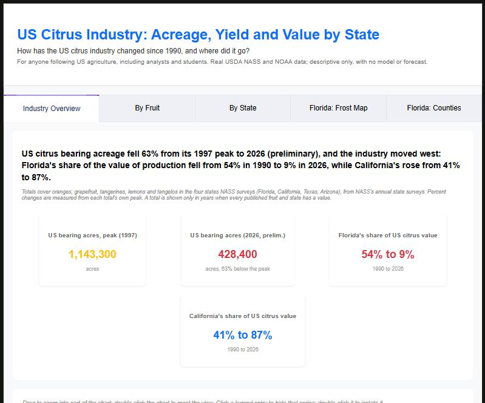

# US Citrus Industry: Acreage, Yield and Value by State



A dashboard of the US citrus industry since 1990: bearing acreage, yield, price and value of production for oranges, grapefruit, tangerines, lemons and tangelos in the four states USDA surveys (Florida, California, Texas and Arizona). It is built from public data from the USDA's National Agricultural Statistics Service (NASS). It asks one question: **how has the US citrus industry changed since 1990, and where did it go?** It is for anyone following US agriculture, including analysts and students.

**Live dashboard:** <https://us-citrus-industry-dashboard.onrender.com/> (free tier: the first load after idle can take about 40 seconds)

## What the data shows

- **US citrus bearing acreage fell 63% from its 1997 peak,** from 1,143,300 acres to 428,400 in 2026 (preliminary), across the four states and five fruits.
- **The industry moved west.** Florida's share of the value of production fell from 54% in 1990 to 9% in 2026, while California's rose from 41% to 87%. Shares compare states in the same year, so inflation does not affect them.
- **Florida lost most of its citrus.** Its bearing acres fell 82% from the 1997 peak (805,900 to 144,900), and its value of production fell 86% from its 2012 peak ($2.09 billion to $0.30 billion, in nominal dollars). Florida orange yield fell 87% from its 2004 peak (428 boxes per acre) to its 2023 low (57), and was 102 in 2026 (preliminary). California's acreage is down only 4% from its 1999 peak, and its value is at its highest in 2026.
- **The mix of fruit changed.** Tangerine acreage grew from 19,800 to 74,300 acres (1990 to 2026), and tangerines are now the highest-value fruit ($1.26 billion in 2026, against $0.98 billion for oranges, in nominal dollars), with lemons also up. Orange acreage is down 56% from 1990 and grapefruit acreage 82%.

Dollar values are nominal (not adjusted for inflation), so the dashboard compares dollars across decades only through shares.

## What the dashboard shows

1. **Industry Overview:** the headline, US bearing acres by state, each state's share of US value, and value of production by fruit.
2. **By Fruit:** pick a fruit and a measure (bearing acres, yield, yield as a share of each state's own peak, utilized production, value, or price per box) and see every state that grows it.
3. **By State:** pick a state and see its acreage and value by fruit.

## Data

| Dataset | Source | Details |
|---|---|---|
| Citrus by fruit and state | USDA NASS QuickStats, state surveys | Oranges, grapefruit, tangerines, lemons, tangelos; Florida, California, Texas, Arizona; 1990-2026; bearing acres, yield, utilized production, value of production, price per box. 2,483 values. NASS labels a season by its end year (2023 is the 2022-23 season). 2026 is preliminary. |

All data are real observations; none is synthetic. The file was pulled on 2026-11-03. How the data were checked, and the rules for totals and gaps, are in [docs/METHODOLOGY.md](docs/METHODOLOGY.md).

## Missing and withheld data

Nothing is estimated or filled in. Of the 2,483 citrus values, 63 are blank: NASS withheld 48 and marked 15 not available, mostly California and Arizona value and price figures for tangerines and lemons in 2009-2016. A total is shown only in years when every published fruit and state has a value, so the value totals have a visible gap in 1991 and 2009-2016, and the acreage total in 2010-2012. One published value is shown as a gap: **NASS's QuickStats gives California's 2022 orange yield as 58 boxes per acre, but its own production and acreage in the same database imply about 285, and NASS's [Citrus Fruits 2022 Summary](https://esmis.nal.usda.gov/sites/default/release-files/j9602060k/pn89ff24k/1544cx74m/cfrt0922.txt) prints 289.** The published value stays in the data file.

## Run it

```bash
git clone https://github.com/brianravelo28/us-citrus-industry-dashboard.git
cd us-citrus-industry-dashboard
python -m venv .venv && source .venv/bin/activate   # Windows: .venv\Scripts\activate
pip install -r requirements.txt
python run_dashboard.py          # http://127.0.0.1:8050  (run from the repo root)
```

Requires Python 3.12 or newer (the pinned numpy needs it); `requirements.txt` is pinned to the versions the live site runs on (Python 3.14), and CI tests Python 3.13 and 3.14. The data file is committed, so the dashboard runs right away. To rebuild it, get a free key from [USDA NASS](https://quickstats.nass.usda.gov/api) and set it as an environment variable (the script stops with a clear message if it is unset, and no key is stored in the code):

```bash
export NASS_KEY=your-nass-key           # PowerShell: $env:NASS_KEY = "your-nass-key"
python src/fetch_industry_data.py        # citrus by fruit and state, with a sanity report
```

A failed API call stops the script and writes nothing.

## Known limitations

- **Dollars are nominal.** They are not adjusted for inflation, so only shares and physical measures (acres, boxes) are compared across decades. Dollar totals use NASS's packinghouse-door equivalent basis.
- **Four states.** NASS surveys citrus in Florida, California, Texas and Arizona. Arizona's oranges stop in 2012, grapefruit in 2009 and tangerines in 2015.
- **Gaps in the totals** (above) mean some peaks and trends cannot be read across 2009-2016.
- **Box weights differ by state,** so yield is compared as a change over time or a share of each state's own peak, not as raw boxes per acre across states. Markets differ too (for example, how much fruit is sold fresh and how much is juiced); that is not measured here.
- **The 2026 values are preliminary** and NASS revises them a year later.
- **Descriptive only.** The data show what changed and where, not why. Disease (citrus greening, HLB), hurricanes, weather, land use and markets are not analyzed.

Possible later additions: weather-based research (for example NOAA station data against yield) and an inflation adjustment for the dollar series.

## Tests

`pytest` runs small checks on the totals rule (a total is blank when a part is missing), the yield cross-check, and the committed data (one row per series and year, 2026 marked preliminary, no forecast rows, every blank has a reason, and the only conflicting yield is California oranges 2022). CI runs them on every push.

## Project structure

```
src/        fetch_industry_data (NASS fetch and sanity report), citrus_data (totals and
            checks), app (Dash dashboard)
tests/      citrus data tests
data/       citrus_by_state.csv
docs/       METHODOLOGY, SCHEMA, API_SOURCES, citations
```

Deployed on [Render](https://render.com) from `main` (see [RENDER_DEPLOYMENT.md](RENDER_DEPLOYMENT.md)); the app reads the committed file, so no API key is needed at runtime.

## License

MIT, see [LICENSE](LICENSE). Data: USDA NASS QuickStats.
