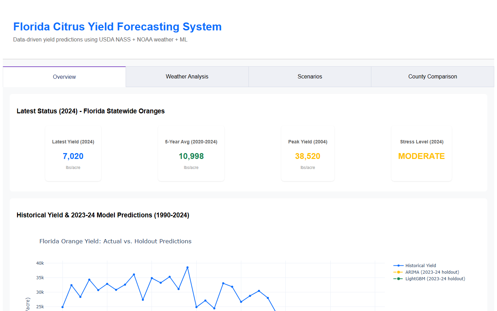

# Florida Citrus Yield Forecasting



A pipeline and interactive dashboard that pulls public data on Florida orange yields (from the USDA's National Agricultural Statistics Service, NASS) and weather (from NOAA, the National Oceanic and Atmospheric Administration), tests whether weather helps predict yield, and compares four large orange-growing counties.

**Live dashboard:** <https://florida-citrus-yield-forecast.onrender.com/> (free tier: the first load after idle can take about 40 seconds)

> **Scope.** USDA publishes citrus yield only for the whole state, so the forecasting models target **statewide** orange yield. Florida's oranges are grown mostly in the central and southern citrus belt (in the 2022 Census, Polk, Hendry, DeSoto and Hardee alone held 58% of the state's bearing orange acres, and the north Florida and Panhandle counties with published totals held 0.4%), so the weather inputs come from two NOAA stations in that region: a regional proxy, not a statewide measurement. The county comparison covers four leading counties (Polk, Hendry, DeSoto, Highlands) and only what is published or measurable: Census acreage and weather from one station per county. No county yield is estimated anywhere in this project.

## Headline findings

- **Florida orange yield fell 87%,** from 38,520 lb/acre in 2004 to 5,130 in 2023. 2024 recovered slightly to 7,020.
- **Bearing orange acreage fell 37% to 47% in every county,** across each county's published Census totals: Polk -46.5% (2002-2022), DeSoto -37.3% (2002-2022), Hendry -44.7% (2012-2022), Highlands -46.3% (2002-2017). The periods differ because USDA withheld some totals.
- **Neither model beats simply repeating last year's yield.** Both over-predicted 2023 and 2024 heavily (ARIMA by 1.7 to 2.3 times, LightGBM by 2.6 to 2.9 times), because neither had seen yields that low in its training years (1990-2022).
- **Weather barely helps predict yield here.** Frost days did not trend up: the station pair used averages 1.9 bloom-season frost days a year in 1990-2007 and 1.8 in 2008-2024. How the model ranks its inputs changed completely when the weather stations changed, so the ranking is only a rough guide.
- **Frost differs sharply between the county stations** (Highlands 6.4 days a year, Polk 1.7), but each number describes one station, and the Highlands station sits in a notably cold spot. Read it as a comparison of stations, not of counties.

## Data

| Dataset | Source | Details |
|---|---|---|
| Statewide orange yield | USDA NASS QuickStats | 1990-2024, converted to lb/acre at 90 lb per box |
| Statewide weather | NOAA daily records (GHCND) | Daily highs, lows and rainfall from two fixed stations, Tampa International and the Archbold Biological Station |
| County acreage | USDA Census of Agriculture | Bearing orange acres, 2002-2022 (every five years), four counties |
| County weather | NOAA daily records | One station per county: Polk (Lakeland 2), Hendry (Moore Haven Lock 1, in neighboring Glades County), DeSoto (Arcadia), Highlands (Archbold) |

Weather is a **proxy**: two stations stand in for the whole state, and neither is in the main Polk grove area. How the stations were chosen, and how sensitive the results are to that choice, is in [docs/METHODOLOGY.md](docs/METHODOLOGY.md).

## Missing and withheld data

Nothing is estimated or filled in. County citrus yield is not published, so the models forecast statewide yield. USDA withheld four county acreage totals (Hendry 2002 and 2007, DeSoto 2012, Highlands 2022); they show as gaps in the dashboard. A weather feature is left blank when too many days are missing (every night for frost; at least 95% of days for summer features), and blanks show as gaps or as *missing*, never as zero. Details and the county selection are in [docs/METHODOLOGY.md](docs/METHODOLOGY.md).

## Pipeline

```bash
git clone https://github.com/brianravelo28/florida-citrus-yield-forecast.git
cd florida-citrus-yield-forecast
python -m venv .venv && source .venv/bin/activate   # Windows: .venv\Scripts\activate
pip install -r requirements.txt
```

Requires Python 3.11 or newer; `requirements.txt` is pinned to the versions the live site runs on (Python 3.14). The cleaned data and results are committed, so the dashboard runs right away:

```bash
python run_dashboard.py          # http://127.0.0.1:8050  (run from the repo root)
```

To rebuild from the source APIs, get free keys from [USDA NASS](https://quickstats.nass.usda.gov/api) and [NOAA](https://www.ncei.noaa.gov/cdo-web/token) and set them as environment variables (the scripts stop with a clear message if a key is unset; no key is stored in the code):

```bash
export NASS_KEY=your-nass-key           # PowerShell: $env:NASS_KEY = "your-nass-key"
export NOAA_API_KEY=your-noaa-token

python src/fetch_data.py                 # yield + statewide weather (a failed call stops the run and writes nothing)
python src/feature_engineering.py        # -> data/df_model.csv
python src/train_models.py               # ARIMA, LightGBM, baselines -> results/
python src/stress_indicator.py           # -> results/stress_indicator.csv
python src/fetch_county_data.py          # county acreage + weather (about 10 minutes)
python src/county_feature_engineering.py # -> data/county_features.csv
python src/station_coverage.py           # optional: re-probe NOAA station coverage
python src/station_sensitivity.py        # optional: results for other station choices
```

## Features

Twelve inputs: bloom-season (Jan-Mar) frost days; summer (May-Aug) temperature averages and spread, growing degree days (a heat measure), and rainfall totals; last year's yield; and a time trend. `temp_variance_grow` is a standard deviation despite its name. Definitions are in [docs/METHODOLOGY.md](docs/METHODOLOGY.md) and columns in [docs/SCHEMA.md](docs/SCHEMA.md).

## Model results

Two models are compared with a **naive baseline: "yield stays at last year's value."** ARIMA (a classic time-series model) uses yield history only; LightGBM (a gradient-boosted tree model) uses the weather, lagged-yield and trend inputs. Errors are RMSE and MAE (typical miss, in lb/acre; lower is better).

**2023-24 holdout (trained on 1990-2022):**

| Method | RMSE | MAE | 2023 pred. | 2024 pred. |
|---|---|---|---|---|
| Actual | - | - | 5,130 | 7,020 |
| Naive, one step | 4,834 | 4,230 | 11,700 | 5,130 |
| ARIMA(1,1,1) | 5,860 | 5,775 | 11,902 | 11,798 |
| LightGBM | 10,521 | 10,508 | 15,100 | 18,066 |

Only two test points, and the methods get different information, so this diagnoses the 2023-24 break rather than ranking the methods.

**Rolling origin, 2008-2024** (17 one-step-ahead folds; each method is fit on earlier years only):

| Method | RMSE | MAE | RMSE, last 5 years |
|---|---|---|---|
| Naive | 4,222 | 3,531 | 3,580 |
| ARIMA | 4,289 | 3,566 | 3,767 |
| LightGBM | 7,278 | 6,015 | 8,363 |

ARIMA is about even with the baseline and LightGBM is clearly worse, over-predicting in every year from 2010 on while yields fell. Weather plus last year's yield adds nothing beyond last year's yield here. With 17 overlapping folds this is a small sample. No forecast beyond 2024 is produced.

## Climate stress indicator

A weather-based score per year (frost, rainfall deviation, heat, plus a low-yield flag; formula in [docs/METHODOLOGY.md](docs/METHODOLOGY.md)). Across 35 years: 6 HIGH (1996, 2001, 2002, 2007, 2010, 2012), 16 MODERATE, 13 LOW. It is unvalidated and misses disease and hurricane damage: it scores 2023, the record-low yield, as MODERATE. Treat it as a descriptive gauge, not a yield-loss predictor.

## Dashboard

A four-tab Plotly Dash app (`src/app.py`): **Overview** (KPIs, yield history with the model predictions, stress timeline); **Weather Analysis** (temperature, rainfall, frost days, feature importance); **Scenarios** (an illustrative slider for more frost days); **County Comparison** (frost days by county, acreage trends with withheld totals as gaps, and a year-by-year panel that opens on 2019, the latest year with complete data for every county).

## Known limitations

- **Weather is approximate.** Two stations represent the state, one station represents each county, and the Hendry station is in the next county over. Tampa is coastal and Archbold is a cold site, so frost levels are not comparable with other sources. FAWN, the University of Florida's agricultural weather network, places stations in growing areas but starts in 1997 and was not used.
- **County series have gaps.** Polk has no weather before 1995, DeSoto after 2021, and several county-years are blank (30 of 140 are missing a value the dashboard shows).
- **Small samples.** The headline holdout has two test points; there is no tuning and no prediction intervals.
- **The 2023-24 collapse is unexplained** by these inputs. Citrus greening (HLB) and hurricane damage are not modelled.
- **The scenario is a stylized example.** It assumes 2,000 lb/acre lost per extra frost day and applies the state average yield to 50,000 acres; see [docs/METHODOLOGY.md](docs/METHODOLOGY.md).
- **Weather windows are offset from the crop year** by roughly a year (NASS labels a season by its end year); the effect was not measured.

## Tests

`pytest` runs small checks on the feature engineering: frost-day counts, the missing-data rules (blank, never zero), the fixed station set, growing degree days, rolling rainfall windows, and withheld acreage staying blank. CI runs them on every push.

## Project structure

```
src/        fetch_data, feature_engineering, train_models, stress_indicator,
            fetch_county_data, county_feature_engineering, station_coverage,
            station_sensitivity, app (Dash dashboard)
tests/      feature-engineering tests
data/       raw and engineered CSVs, station coverage matrix
results/    model results, stress indicator, station sensitivity
docs/       METHODOLOGY, SCHEMA, API_SOURCES, WALKTHROUGH, citations
```

Deployed on [Render](https://render.com) from `main` (see [RENDER_DEPLOYMENT.md](RENDER_DEPLOYMENT.md)); the app reads the committed files, so no API keys are needed at runtime.

## License

MIT, see [LICENSE](LICENSE). Data: USDA NASS QuickStats, USDA Census of Agriculture, NOAA NCEI Global Historical Climatology Network (daily).
