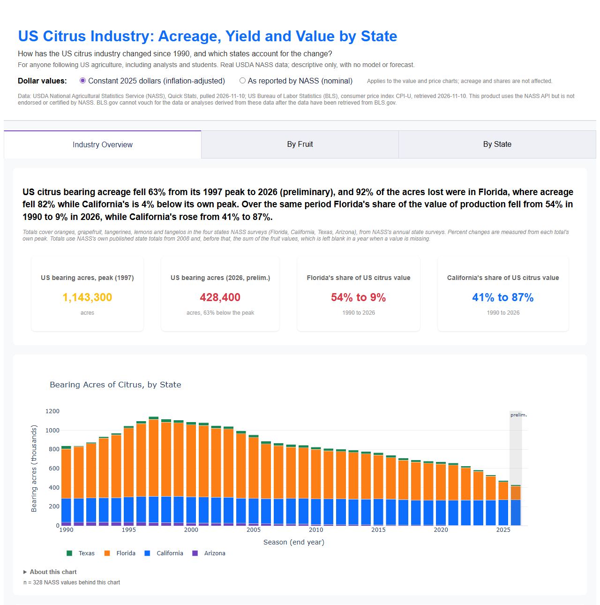

# US Citrus Industry: Acreage, Yield and Value by State



<https://us-citrus-industry-dashboard.onrender.com/> (free tier: the first load after idle can take up to a minute)

A dashboard of the US citrus industry from 1990 to 2026: bearing acreage (acres of trees old enough to bear fruit), yield, price and value of production (the crop's value at the packinghouse door, where fruit is first sold) for oranges, grapefruit, tangerines, lemons and tangelos in the four states USDA surveys (Florida, California, Texas and Arizona). Dollar values are shown in constant 2025 dollars or as reported, and acreage and state shares compare seasons without any price adjustment.

## Headline

US citrus bearing acreage fell 63% from its 1997 peak, from 1,143,300 acres to 428,400 in 2026 (preliminary), and Florida accounts for 92% of the acres lost (n = 328 NASS values behind the acreage chart). Without Florida, acreage in the other three states is 16% lower (337,400 to 283,500 acres). The figures cover oranges, grapefruit, tangerines, lemons and tangelos in the four states NASS surveys; 2026 is NASS's August estimate and is revised a year later.

## Who's this for?

Analysts, students and anyone following US agriculture

## What can it do?

It can answer these questions:

1. How many bearing acres of oranges did Florida have in 1997 compared with 2026? (By Fruit tab, Oranges, Bearing acres; n = 131)
2. What was California's value of production in 2018 and in 2026, in constant 2025 dollars? (By State tab, California; n = 135)
3. In 2014, which state had the larger share of the US value of production, Florida or California? (Industry Overview, share chart; n = 314)

## How to use it?

Set the dollar toggle at the top to constant 2025 dollars or as reported, then use the three tabs: Industry Overview (US totals and state shares), By Fruit (pick a fruit and a measure) and By State (pick a state). Every chart has a collapsed "About this chart" section with definitions, scope and caveats, and a count of the NASS values behind it; a count under 30 carries an asterisk.

## Data

| Source | What |
|---|---|
| [USDA NASS Quick Stats](https://quickstats.nass.usda.gov/) | Survey estimates by fruit and state: bearing acres, yield, utilized production, value of production and price per box, 1990-2026; 2,483 rows (`data/citrus_by_state.csv`). NASS's own all-citrus state totals for bearing acres and value, 2008-2026; 152 rows (`data/citrus_totals_by_state.csv`). Pulled 2026-11-10. |
| [BLS consumer price index](https://www.bls.gov/cpi/) | CPI-U, all items, US city average, monthly, October 1989 to October 2026; 445 rows (`data/cpi_u_monthly.csv`). Retrieved 2026-11-10. |

All data are real observations; none is synthetic. `data/manifest.json` records each file's source, pull date and SHA-256. Of the fruit rows, 63 are blank (NASS withheld 48 and marked 15 not available); nothing is estimated. NASS data are used under the [NASS API Terms of Service](https://quickstats.nass.usda.gov/api): this product uses the NASS API but is not endorsed or certified by NASS. BLS content is in the public domain; BLS.gov cannot vouch for the data or analyses derived from these data after the data have been retrieved from BLS.gov.

## Reading the numbers

- **Seasons.** NASS labels a season by its end year (2023 is the 2022-23 season); 2026 is preliminary and revised a year later.
- **Value of production.** The utilized crop valued at the packinghouse-door price, not the industry's revenue.
- **Dollars.** Constant 2025 dollars use the BLS consumer price index for all items, a general price level and not a citrus price index. The 2026 season averages 11 months because BLS published no value for October 2025. Acreage and shares are not affected.
- **Boxes.** Box weights differ by fruit and state, so yield is compared as a change over time or a share of a state's own peak.
- **Totals and gaps.** A sum of fruit values is blank in a year with a missing value (1991 and 2009-2016). From 2008 the totals use NASS's own state totals, which include the withheld values; where both exist, the fruit sums equal NASS's acreage totals in every state-year and its value totals within 1%.
- **One flagged yield.** NASS's QuickStats gives California's 2022 orange yield as 58 boxes per acre, but its own production and acreage imply about 285, and its printed summary says 289. The dashboard draws it as a gap ([details](docs/METHODOLOGY.md#checks-on-the-data)).
- **Changes, not causes.** The figures show what changed and where, not why.

[docs/METHODOLOGY.md](docs/METHODOLOGY.md) lists every cleaning step with its counts.

## What the data shows

- **Florida shrank and California did not.** Of the 714,900 bearing acres the US lost from 1997 to 2026, Florida lost 661,000 (92%); California's acreage is 4% below its 1999 peak. Florida's share of the value of production fell from 54% in 1990 to 9% in 2026, while California's rose from 41% to 87%.
- **The industry's value fell once prices are taken out.** In 2025 dollars the US value of production was $5.49 billion in 1990 (the highest year in the data) and $3.05 billion in 2026 (preliminary), 45% lower. In dollars as reported the highest year is 2012 ($3.71 billion) and 2026 is 15% lower; the two differ because prices rose over the period.
- **Florida's citrus fell furthest.** Its bearing acres fell 82% from the 1997 peak (805,900 to 144,900). Its value of production fell 92% from its 1991 peak in 2025 dollars ($3.72 billion to $0.29 billion), and 86% from its 2012 peak in dollars as reported ($2.09 billion to $0.29 billion). Orange yield fell 87% from its 2004 peak (428 boxes per acre) to its 2023 low (57), and was 102 in 2026 (preliminary). California's value is at its highest in 2026 in dollars as reported, but in 2025 dollars it is 14% below its 2018 peak ($3.07 billion).
- **The mix of fruit changed.** Tangerine acreage grew from 19,800 to 74,300 acres (1990 to 2026), and in 2026 (preliminary) tangerines were the highest-value fruit ($1.26 billion, against $0.98 billion for oranges, in dollars as reported). Orange acreage is down 56% from 1990 and grapefruit acreage 82%.

## Run it

Python 3.12 or newer (the pinned numpy needs it); `requirements.txt` is pinned to the versions the live site runs on (Python 3.14).

```bash
git clone https://github.com/brianravelo28/us-citrus-industry-dashboard.git
cd us-citrus-industry-dashboard
python -m venv .venv && source .venv/bin/activate   # Windows: .venv\Scripts\activate
pip install -r requirements.txt
python run_dashboard.py          # http://127.0.0.1:8050  (run from the repo root)
```

The data files are committed, so the dashboard runs right away. To rebuild them, get a free key from [USDA NASS](https://quickstats.nass.usda.gov/api) and set it as an environment variable (a failed call stops the script and writes nothing; no key is stored in the code):

```bash
export NASS_KEY=your-nass-key           # PowerShell: $env:NASS_KEY = "your-nass-key"
python src/fetch_industry_data.py       # citrus by fruit and state, plus NASS's state totals, with a sanity report
python src/fetch_cpi.py                 # BLS consumer price index (no key needed)
```

The app reads the committed files, so no key is needed at runtime. It is hosted on [Render](https://render.com) from `main` (see [RENDER_DEPLOYMENT.md](RENDER_DEPLOYMENT.md) and `render.yaml`) and serves `/healthz` and `/debugz` for the host.

## Tests

56 tests run in about 20 seconds with no network or API key. They check the totals and constant-dollar rules, the price-index fetch (against mocked responses), every dashboard control in both dollar modes, the layout and endpoints, and the data manifest; `src/doc_figures.py` recomputes every figure quoted in the documents, and a test fails if one is no longer stated. They do not cover the live deployment or how the page looks; those are checked by hand after each deploy. CI runs them on Python 3.13 and 3.14 ([the full list](docs/METHODOLOGY.md#reproducibility)).

```bash
pip install -r requirements.txt pytest
python -m pytest
```

## Files

| File | Purpose |
|---|---|
| `src/app.py` | The Dash dashboard |
| `src/citrus_data.py` | Totals, constant dollars and data checks |
| `src/fetch_industry_data.py`, `src/fetch_cpi.py` | NASS and BLS fetch scripts |
| `src/manifest.py`, `src/doc_figures.py` | Data manifest; recomputes the figures the documents quote |
| `data/` | The three CSV files and `manifest.json` |
| `tests/` | The test suite |
| `docs/` | Methodology, schema, API notes, citations |
| `render.yaml`, `RENDER_DEPLOYMENT.md` | Hosting |
| `run_dashboard.py`, `requirements.txt` | Local launcher, pinned dependencies |

Possible later addition: weather-based research (for example NOAA station data against yield).

Released under the MIT License.
